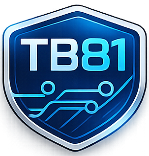

# TechBot_Blender_MCP

Created by **Techbot81**.

TechBot_Blender_MCP connects an external Model Context Protocol (MCP) service to a Blender extension through a local bridge. The extension provides typed inspection and modeling operations; Blender API work is scheduled on Blender's main thread.

## Project layout

- `blender_addon/universal_mcp/` — Blender extension and bridge handlers.
- `mcp_service/` — external MCP server, validation, orchestration and transports.
- `shared/` — shared schemas and protocol models.
- `tests/` — unit, protocol, security and Blender integration tests.

The extension archive and the external MCP service are separate components. Installing the extension does not install or configure an MCP client.

## Safety

Tool calls use typed schemas and validation. Scene changes are subject to the configured approval policy and bridge-side credential checks. Caller-provided approval flags do not authorize mutations. See [Security](docs/publication/SECURITY.md) and [Architecture](docs/publication/ARCHITECTURE.md).

## Compatibility

Blender 5.2.2 LTS has been used for package registration checks. Client support requires documented end-to-end discovery and invocation evidence; consult [Compatibility](docs/publication/COMPATIBILITY.md).

## Installation

Follow [Installation](INSTALL.md). Use only a published release whose checksum is verified. Release candidate packages (such as `TechBot_Blender_MCP-1.0.0-rc2.zip`) in this project are evaluation artifacts and are not represented as final public releases.

## License

The project license text is in the root [`LICENSE`](LICENSE) file.
